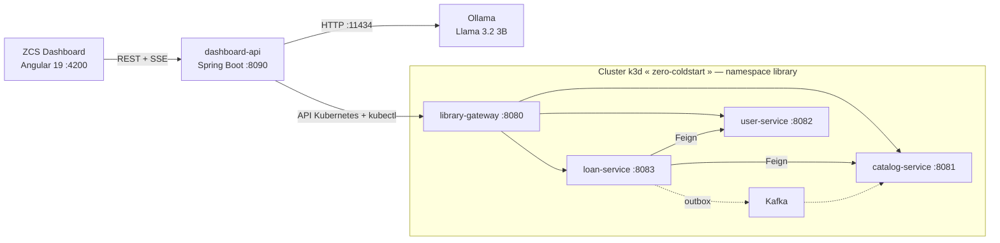

# ZCS — Zero Cold Start : Spring Boot 3 + GraalVM Native Image sur Kubernetes


Étude expérimentale du **cold start** dans une architecture microservices cloud-native : une même application Spring Boot 3 est déployée en version **JVM** et en version **GraalVM Native Image** dans un cluster Kubernetes local, puis comparée (démarrage, mémoire, latence, coût). Le dépôt contient aussi le **ZCS Dashboard**, un outil de pilotage qui permet de construire, déployer, mesurer et comparer les deux variantes depuis une interface web.

> Projet réalisé dans le cadre d'un mémoire de Master 2 Génie Logiciel.

## Sommaire

1. [Résultats clés](#résultats-clés)
2. [Architecture](#architecture)
3. [Structure du dépôt](#structure-du-dépôt)
4. [Prérequis](#prérequis)
5. [Démarrage rapide](#démarrage-rapide)
6. [ZCS Dashboard](#zcs-dashboard)
7. [Migration GraalVM : problèmes résolus](#migration-graalvm--problèmes-résolus)
8. [Benchmarks](#benchmarks)
9. [Limites connues](#limites-connues)
10. [Contexte académique et licence](#contexte-académique-et-licence)

---

## Résultats clés

Campagne de novembre 2026. Machine : Intel i5-12450H, WSL2 (8 vCPU, 12 Go), Docker 28.1.1, k3s v1.31.5, Oracle GraalVM 21.0.5. Chaque pod est limité à 1 cœur et 1 Gio, une réplique par service. JVM et Native sont construits depuis les mêmes sources. Valeurs : médiane de 10 essais (démarrage), de 5 relevés (mémoire), de 5 runs de 1 000 requêtes après 10 000 requêtes de chauffe (latence).

### Démarrage

| Service | Startup applicatif (log Spring) | Cold start (appli prête) | Gain |
|---|---|---|---|
| catalog-service | 19,84 s → 0,82 s | 20,74 s → 1,78 s | ×11,7 |
| user-service | 19,47 s → 0,80 s | 20,41 s → 1,71 s | ×11,9 |
| loan-service | 22,22 s → 1,40 s | 23,11 s → 2,37 s | ×9,8 |
| library-gateway | 17,43 s → 0,20 s | 18,33 s → 1,08 s | ×17,0 |

### Mémoire au repos et taille d'image

| Service | Mémoire JVM → Native | Image JVM → Native |
|---|---|---|
| catalog-service | 342 → 132 Mi (−61 %) | 359,7 → 324,7 Mo (−10 %) |
| user-service | 309 → 130 Mi (−58 %) | 350,5 → 292,0 Mo (−17 %) |
| loan-service | 309 → 119 Mi (−62 %) | 361,1 → 295,8 Mo (−18 %) |
| library-gateway | 185 → 79 Mi (−57 %) | 317,8 → 187,4 Mo (−41 %) |

### Latence en régime établi (p50, ms)

| Service | JVM | Native | Native / JVM |
|---|---|---|---|
| catalog-service | 5,14 | 6,06 | ×1,18 |
| user-service | 4,37 | 5,15 | ×1,18 |
| loan-service | 5,23 | 6,10 | ×1,17 |
| library-gateway | 7,22 | 7,44 | ×1,03 |

Le natif atteint sa latence nominale dès les premières requêtes ; la JVM démarre environ 1,7 fois plus lente (catalog, 500 premières requêtes) puis converge après quelques milliers de requêtes et finit environ 15 % plus rapide sur les services à base de données. Le natif gagne donc au démarrage et en mémoire ; la JVM reste meilleure en régime établi prolongé.

### Disponibilité vue par Kubernetes

Avec les sondes d'origine (startupProbe à 30 s), le pod natif n'est « Ready » qu'à environ 30,7 s, contre 31,7 s en JVM : le gain est annulé. Avec les mêmes sondes rapides pour les deux modes (période de 1 s), le natif est Ready en 2 à 3 s contre 18 à 23 s en JVM (×6,7 à ×9,2). Les sondes d'un déploiement natif doivent être adaptées.

### Débit

Sur `user-service`, la JVM chauffée débite 622 req/s contre 449 pour le natif (−28 %). Sur les trois autres services, le débit sous 10 connexions est plafonné à environ 100 req/s pour les deux variantes, attribué au quota CPU de MySQL (limité sur 97 % des périodes pendant la charge) : ces mesures ne permettent pas de comparer JVM et Native.

---

## Architecture



### Application métier : Library (4 services Spring Boot 3)

| Service | Port | Rôle | Technologies |
|---|---|---|---|
| `library-gateway` | 8080 | Point d'entrée, routage | Spring Cloud Gateway |
| `catalog-service` | 8081 | Catalogue de livres, stock | JPA, MySQL, Redis, Kafka |
| `user-service` | 8082 | Utilisateurs | JPA, MySQL, Redis |
| `loan-service` | 8083 | Emprunts | JPA, MySQL, Kafka (outbox), Feign, Resilience4j |

Infrastructure déployée dans le namespace `library` : MySQL ×3 (une base par service), Redis ×2, Kafka + Zookeeper (service `kafka-broker`) et Zipkin pour le traçage distribué.

### Système de pilotage : ZCS Dashboard

| Composant | Port | Rôle |
|---|---|---|
| `dashboard-api` | 8090 | Backend Spring Boot 3 : API REST + SSE pour piloter le cluster |
| `dashboard-ui` | 4200 | Frontend Angular 19 + PrimeNG 19 |

Le `dashboard-api` s'exécute **hors du cluster**, sur la machine hôte (WSL). Il agit de trois façons : par le client Kubernetes Fabric8 (état du cluster, bascule JVM↔Native, variantes A/B), par des commandes shell (`mvn`, `docker`, `k3d`, `kubectl`) pour les builds et benchmarks, et par HTTP pour le test de charge A/B et l'appel à Ollama. Les résultats sont persistés en fichiers CSV, sans base de données.

---

## Structure du dépôt

```
.
├── library-gateway/          # Service 1 : passerelle
├── catalog-service/          # Service 2 : catalogue
├── user-service/             # Service 3 : utilisateurs
├── loan-service/             # Service 4 : emprunts
├── dashboard-api/            # Service 5 : backend de pilotage
├── dashboard-ui/             # Frontend Angular
├── k8s/                      # Manifests Kubernetes (namespace, MySQL, Redis, Kafka, Zipkin, deployments)
├── zero-coldstart-bench/     # Scripts : benchmark.sh, compare.sh, load-test.sh, coldstart-test.sh
└── README.md
```

---

## Prérequis

| Outil | Version testée | Remarque |
|---|---|---|
| Windows 11 + WSL2 (Ubuntu) | 24.04 | Linux natif possible |
| Docker Desktop | 4.41 | Intégration WSL activée |
| k3d + kubectl | Kubernetes v1.31.5+k3s1 | |
| GraalVM (Oracle) | 21.0.5 | Via SDKMAN, pour les builds natifs |
| Apache Maven | 3.9.x | |
| Node.js + Angular CLI | Node 20, CLI 19 | Pour le frontend |
| Ollama + `llama3.2:3b` | — | Optionnel : uniquement pour la page Recommandations |

Une compilation native demande environ **8 à 9 Go de RAM** et dure de 8 à 27 minutes selon le service.

---

## Démarrage rapide

### 1. Créer le cluster et déployer l'infrastructure

```bash
k3d cluster create zero-coldstart        # ajouter vos options de ports/agents si besoin
kubectl create namespace library
kubectl apply -n library -f k8s/         # adapter selon l'organisation du dossier k8s/
```

### 2. Construire les images des 4 services

Le dashboard attend deux tags par service : `<service>:jvm` et `<service>:native`.

Le plus simple est de passer par la **page Build du dashboard** (étape 4), qui enchaîne compilation, image Docker, import dans k3d et redémarrage du déploiement. La séquence exacte est dans `dashboard-api/.../service/BuildService.java`.

Construction JVM manuelle d'un service :

```bash
cd catalog-service
mvn clean package -DskipTests
docker build -t catalog-service:jvm .
k3d image import catalog-service:jvm -c zero-coldstart
kubectl rollout restart deployment/catalog-service -n library
```

### 3. Lancer le backend de pilotage

```bash
cd dashboard-api
mvn clean package -DskipTests
java -jar target/dashboard-api-1.0.0.jar        # http://localhost:8090
```

Configuration par variables d'environnement (valeurs par défaut relatives au répertoire personnel) :

| Variable | Rôle | Défaut |
|---|---|---|
| `PROJECT_BASE_PATH` | Racine des projets | `${user.home}/library-microservices` |
| `RESULTS_PATH` | Résultats de benchmark (CSV) | `${user.home}/benchmark-results` |
| `BENCHMARK_SCRIPT` | Script de benchmark | `${user.home}/zero-coldstart-bench/benchmark.sh` |
| `COLDSTART_SCRIPT` | Script de cold start | `${user.home}/zero-coldstart-bench/coldstart-test.sh` |

Le namespace et les chemins sont aussi modifiables à chaud : `PUT /api/config/namespace`, `/basePath`, `/resultsPath`, ou page *Paramètres* du dashboard.

### 4. Lancer le frontend

```bash
cd dashboard-ui
npm install --legacy-peer-deps
ng serve --port 4200                            # http://localhost:4200
```

### 5. (Optionnel) IA locale pour l'analyse des logs

```bash
ollama pull llama3.2:3b
ollama serve                                    # port 11434
```

### 6. Vérifier le système Library

```bash
kubectl port-forward -n library svc/library-gateway 8080:8080 &

curl -X POST localhost:8080/api/users -H "Content-Type: application/json" \
  -d '{"name":"Test User","email":"test@test.com","role":"USER"}'

curl -X POST localhost:8080/api/books -H "Content-Type: application/json" \
  -d '{"title":"Clean Code","author":"Robert Martin","category":"Informatique","availableStock":5}'

curl -X POST localhost:8080/api/loans -H "Content-Type: application/json" \
  -d '{"userId":1,"bookId":1}'

curl localhost:8080/api/books       # le stock doit être décrémenté (événement Kafka)
```

---

## ZCS Dashboard

Interface web (thème clair et sombre, bouton dans la barre supérieure) en 9 pages :

| Page | Fonction |
|---|---|
| État du cluster | Pods, mode JVM/Native, CPU/RAM, logs en direct, bascule JVM↔Native, redémarrage |
| Build | Build JVM ou natif avec progression GraalVM `[1/8]`→`[8/8]` en direct, annulation |
| Benchmarks | Lancement des benchmarks JVM et Native, suivi en direct |
| Comparaison | Tableau et graphique JVM vs Native, export PDF et LaTeX |
| A/B Test | Déploie les deux variantes en parallèle et mesure latence moyenne, P95, taux de succès |
| Historique | Évolution des runs, tendances (IMPROVING / STABLE / DEGRADING), alertes de régression (seuil 10 %) |
| Recommandations | Analyse de logs de compilation : moteur de règles + Llama 3.2 (Ollama) |
| Coût cloud | Simulation AWS Lambda, Google Cloud Run, Azure Container Apps |
| Paramètres | Namespace, chemins du projet |

L'état des builds, benchmarks et tests A/B est conservé quand on change de page.

### API du backend (une cinquantaine d'endpoints REST et SSE)

| Préfixe | Contenu |
|---|---|
| `/api/cluster` | Infos, pods, découverte de services, déploiement/bascule, scaling, redémarrage |
| `/api/build` | Build JVM/natif, flux SSE, statut, annulation |
| `/api/benchmark` | Lancement, flux SSE, métriques, comparaison |
| `/api/monitoring` | Pods en direct (SSE), logs en streaming, métriques CPU/RAM |
| `/api/abtest` | Setup, exécution, statistiques, résultats, suppression |
| `/api/regression`, `/api/history` | Détection de régression, historique, tendances |
| `/api/cost` | Simulation de coût cloud |
| `/api/recommendations`, `/api/ai` | Analyse par règles et par Llama 3.2 |
| `/api/export` | Rapport PDF et LaTeX |
| `/api/config` | Configuration à chaud |

Exemple : `curl http://localhost:8090/api/cluster/pods`

---

## Migration GraalVM : problèmes résolus

La migration des 4 services vers Native Image a nécessité de résoudre sept problèmes. Ils constituent une contribution méthodologique de l'étude.

| Problème | Solution |
|---|---|
| Log4j2 incompatible avec Native Image | Remplacement par SLF4J (`@Slf4j`), suppression de `spring-boot-starter-log4j2` |
| Proxies dynamiques Feign non enregistrés | `RuntimeHintsRegistrar` avec `registerJdkProxy` |
| Désérialisation Jackson des DTO bloquée | `@RegisterReflectionForBinding` (+ `@JsonAutoDetect`) |
| URLs Feign figées à la compilation AOT | URLs des services Kubernetes dans `application.yaml` |
| Deadlock du watchdog à l'étape `[6/8]` sur WSL2 | `-H:DeadlockWatchdogInterval=60`, `--gc=G1`, `-J-Xmx8g`, `-J-XX:ActiveProcessorCount=4` |
| Sonde Zookeeper en échec (`ruok`) | Remplacement par la commande `srvr` |
| Conflit de nom `kafka` avec les variables Kubernetes | Service renommé `kafka-broker` |

---

## Benchmarks

Les scripts de `zero-coldstart-bench/` mesurent le temps de démarrage, le cold start Kubernetes (3 essais par service), la mémoire au repos et sous charge, la taille des images et le débit. `compare.sh` produit le tableau comparatif JVM vs Native. Les résultats sont écrits en CSV horodatés dans `RESULTS_PATH`, dont se servent la page Historique et la détection de régression.

---

## Limites connues

- Le `dashboard-api` s'exécute sur l'hôte et lance des commandes shell (`kubectl`, `docker`, `k3d`, `mvn`).
- Une seule machine, une réplique par service ; les pods sont limités à 1 cœur, ce qui influence la chauffe de la JVM.
- La latence est mesurée à travers `kubectl port-forward` (coût constant pour les deux variantes) ; les écarts relatifs sont donc sous-estimés.
- Le débit des services à base de données n'est pas exploitable (plafond MySQL).
- Les gains de démarrage dépendent de la définition retenue (démarrage applicatif, cold start, Ready) ; les trois sont fournis.
- Les coûts cloud sont une simulation fondée sur des hypothèses (5 % de cold start) à recalculer avec ces mesures.
- Le client `kubectl` (v1.36) est hors du décalage de version supporté par le serveur (v1.31).
---

## Contexte académique 

- **Sujet** : Conception, implémentation et étude d'une architecture cloud-native optimisée pour le Zero Cold Start avec Spring Boot 3 et GraalVM Native Image
- **Auteur** : `TATOA N. Yannik`
